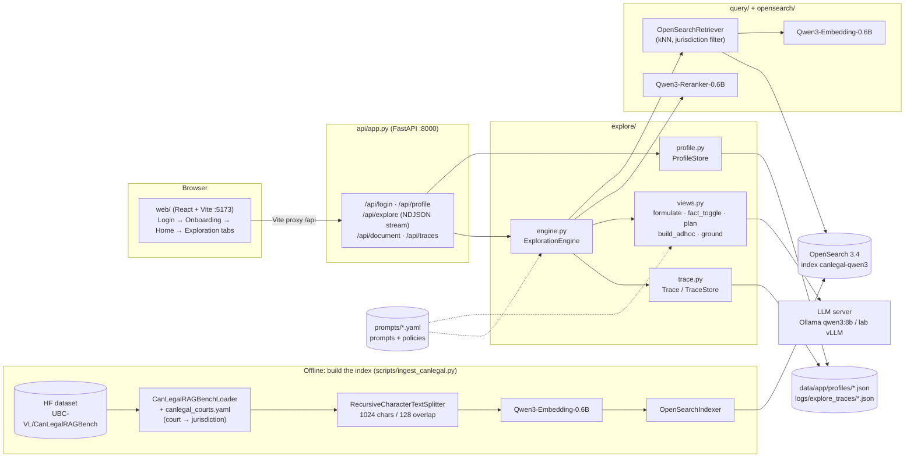
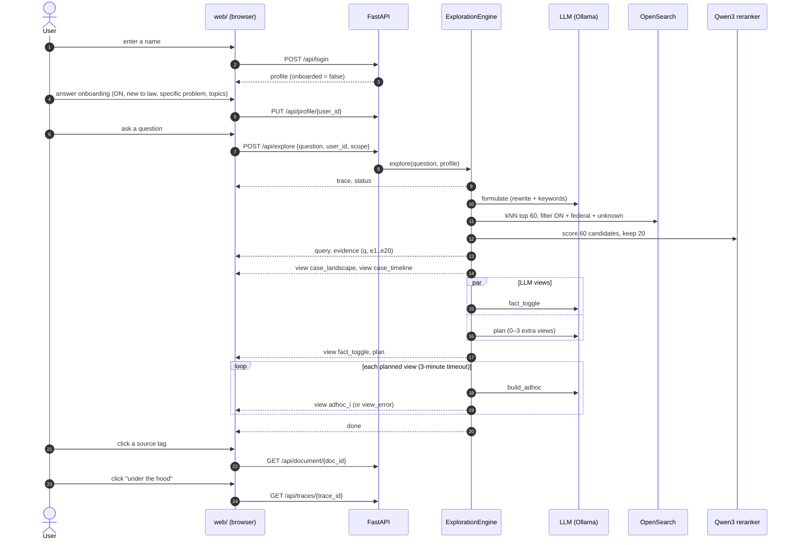

# `legalrag`: backend package

A Python 3.11 package behind the LegalRAG Explore web app (`web/`) and the LegalBench-RAG
evaluation (`evaluation/`). Both share its ingestion, search and LLM plumbing.

Stack:
- **FastAPI + uvicorn:** HTTP API with NDJSON streaming.
- **pydantic / pydantic-settings:** schemas and configuration.
- **pydantic-ai:** LLM agents with validated structured output, over any OpenAI-compatible server (Ollama, vLLM, HF router, OpenAI).
- **opensearch-py:** search.
- **sentence-transformers / transformers:** embedders and rerankers.

Install with `pip install -r requirements.txt`, which pins versions and installs this
package in editable mode. Setup and run steps are in the [root README](../README.md#run-the-website-on-localhost).

## Architecture



## How a request runs, end to end

The example below is a real run on a MacBook (M2, 32 GB) with Ollama `qwen3:8b`.
Its trace is `5ce32f64fd43`, and timings will differ on other machines.



### 1. Log in

A new user types the name **"Readme Demo"** on the login page.
- `POST /api/login {"display_name": "Readme Demo"}` → `ProfileStore.login()` derives the id
  `readme-demo` and creates `data/app/profiles/readme-demo.json`.
- The response has `"onboarded": false`, so the UI opens onboarding.
- The browser remembers the id in `localStorage`, so the next visit skips this step.

This login is for development only: no password, and anyone can type any name.

### 2. Build the profile

Onboarding asks one question per step. The options come from `GET /api/options`, which
reads `profile:` in `prompts/explore_policy.yaml`. Our user picks:

| Step | Answer | What it changes later |
|---|---|---|
| Location | Ontario (`ON`) | Retrieval filter: `ON` + `federal` + `unknown` (`jurisdiction_policy.always_include`). "Explore all of Canada", "Outside Canada" and "Prefer not to say" mean no filter. |
| Familiarity | New to law | The `audience` text in every LLM prompt (plain language) |
| Goal | I have a specific situation: "My landlord is keeping my deposit" | The planner's `planner_hint` |
| Topics | Housing & tenancy | Passed to the planner as interests |

`PUT /api/profile/readme-demo` validates the answers (`profile.validate_update`) and saves
them. The Home page then shows benchmark questions for Ontario (`GET /api/examples?province=ON`).

### 3. Ask a question

The user asks: **"Can my landlord keep my last month's rent deposit when I move out?"**

The browser sends `POST /api/explore {"question": …, "user_id": "readme-demo", "scope": "profile"}`
and reads the NDJSON response line by line (`web/src/api.js → exploreStream`). The engine
first emits `{"event":"trace","trace_id":"5ce32f64fd43"}`, so the UI's "under the hood"
panel can follow the run live.

### 4. Rewrite the question for search: 12.6 s

`views.formulate` sends the question to the LLM with the system prompt from
`prompts/formulator.yaml`. It returns a validated `QueryRewriteOutput`:

- **rewrite:** "Can landlord retain last month's rent deposit upon tenant moving out"
- **keywords:** landlord, tenant, rent deposit, moving out, retain, retain deposit

If the LLM call fails, the engine searches with the raw question and emits a `view_error`.

### 5. Retrieve: 1.8 s

`engine._search` embeds the rewrite with Qwen3-Embedding-0.6B and runs a kNN query on
`canlegal-qwen3`, top 60 (`retrieval.top_k`), filtered to `jurisdiction ∈ {ON, federal,
unknown}`. With fewer than `min_results` (8) hits it would drop the filter, report
`relaxed: true`, and the UI would say "Few local sources — all of Canada".

Top candidates: 2017 ONSC 4487, 2014 ONSC 116, 2012 HRTO 1507, 2011 TCC 112, ….

### 6. Rerank: 23.0 s

`engine._rerank` scores all 60 candidates with Qwen3-Reranker-0.6B. The score is
P("yes") for "does this passage help answer the query?", using the instruction in
`explore_policy.yaml → reranker`. The best 20 (`retrieval.evidence_k`) become the
evidence: `e1`…`e20`, plus `q` for the question itself. The engine streams them as
`query` and `evidence` events. In this run: **20 passages from 8 documents**.

Each passage keeps its `doc_id` and character offsets. The Sources tab fetches the full
document (`GET /api/document/{doc_id}`) and highlights the passage at those offsets.

### 7. Built-in views: under 0.1 s, no LLM

`views.case_landscape` and `views.case_timeline` group the evidence by document,
jurisdiction and year, and are streamed straight away. About **37 s** after the question,
the Cases and Timeline tabs are usable.

### 8. LLM views, in parallel

Both prompts get the same context (`views.prompt_context`): the question, the profile's
audience, goal hint, interests and province, and the top 15 passages
(`retrieval.llm_evidence_k`). Every prompt is in `prompts/explore_views.yaml`.

- **Fact toggles** (`views.fact_toggle`, 282 s): 7 facts that would change the picture.
  Each has a status (stated, assumed or unknown), why it matters, what changes if it's
  different, and its evidence ids. Examples: "I moved out of my rental property"
  (stated, from `q`); "Were there any damages or unpaid rent?" (unknown); "Did the
  landlord provide an itemized list of deductions?" (unknown). These drive the What-if tab.
- **Planner** (`views.plan`, 61 s): it names the topic and writes a ≤2-sentence
  orientation and 5 follow-up questions. It decides whether extra views would help, and
  which ones, from the catalog in `explore_views.yaml`. Here it chose **legal_test**,
  **rule_hierarchy** and **scenario_timeline**, and gave a reason for each (`why_useful`).
  For example, legal_test: "helps you understand the legal steps and conditions that
  determine whether your deposit can be withheld". One follow-up: "Can my landlord use
  my deposit to cover damages or unpaid rent?" Follow-ups appear on the Overview tab; a
  click starts a new exploration.

### 9. Extra views: up to 3 minutes each

Each planned view is built by `views.build_adhoc` with its catalog prompt and output
schema (`schemas.ADHOC_OUTPUTS`). The view must finish within
`planner.extra_view_timeout_s` (180 s), or the UI shows "timed out". Successful views
appear in the Relations tab (called Maps at the time), drawn by the Demo renderers.

**In this run all three timed out.** Ollama answers one request at a time by default, so
the three views queued behind the fact-toggle call (282 s) and used up their 180 s
waiting. This is the laptop limitation. On the lab vLLM, which serves requests in
parallel, they run side by side. On a laptop you can raise
`planner.extra_view_timeout_s` or start Ollama with `OLLAMA_NUM_PARALLEL=2` (more memory).

### 10. Grounding

Before a view is sent, `views.ground` walks the spec and checks every `evidence_ids` list.
It removes ids that aren't among `q, e1..e20`, and counts each item as backed or unbacked.
The counts are kept as the view's `audit`; the UI hides unbacked items. Every visible
claim links back to a passage.

### 11. Done: 319.6 s

The engine emits `done`, and `Trace.finish()` writes
`logs/explore_traces/<date>/<time>_5ce32f64fd43.json`. It holds every step, all 60
candidates with both scores, and every LLM call (prompts, raw response, tokens, retries,
errors). The server log has one line per step:

```
[5ce32f64fd43] explore start | scope=profile | province=ON familiarity=new goal=specific_problem | question=Can my landlord keep …
[5ce32f64fd43] LLM  formulate     12.6s | model=qwen3:8b | tokens in=275 out=79 | retries=0
[5ce32f64fd43] step retrieve       1.8s | mode=semantic | top_k=60 | jurisdictions=ON, federal, unknown | relaxed=False
[5ce32f64fd43] step rerank        23.0s | model=Qwen/Qwen3-Reranker-0.6B | keep=20
[5ce32f64fd43] LLM  plan          61.0s | model=qwen3:8b | tokens in=4535 out=476 | retries=0
[5ce32f64fd43] step adhoc_0:legal_test  180.0s | ERROR TimeoutError
[5ce32f64fd43] LLM  fact_toggle  282.1s | model=qwen3:8b | tokens in=4190 out=1428 | retries=0
[5ce32f64fd43] step fact_toggle  282.2s | audit={"backed_items": 7, "unbacked_items": 0, "invalid_ids_removed": 0}
[5ce32f64fd43] explore done in 319.6s [formulate=12.6s, retrieve=1.8s, rerank=23.0s, …]
```

If the browser disconnects mid-run (new question, tab closed), pending LLM tasks are
cancelled, so Ollama doesn't keep working on an abandoned run.

## Layout

```
legalrag/
├── api/app.py              FastAPI endpoints for the exploration UI
├── explore/                exploration app logic
│   ├── engine.py           ExplorationEngine: one question → stream of events; document reader
│   ├── views.py            view builders: built-in (no LLM), query rewrite, LLM views, planner,
│   │                       grounding; LLM agent factory (_agent/_run) + per-call trace capture
│   ├── schemas.py          Evidence / View envelopes + LLM output schemas (match Demo renderers)
│   ├── profile.py          UserProfile + ProfileStore (JSON files, dev only); filter_province
│   ├── chat.py             Ask panel: streamed answer grounded in the run's evidence, [eN] cleanup
│   ├── demos.py            Home page example questions per location + precomputed demos (data/demos/)
│   └── trace.py            Trace (per-run record + INFO log lines) + TraceStore
├── core/
│   ├── config.py           Settings from .env (LLM_* incl. LLM_THINKING_OFF, EMBEDDING_*, OPENSEARCH_*, EXPLORE_*, …)
│   ├── models.py           shared domain models: RawDocument, Chunk, StructuredQuery, RetrievedChunk
│   └── interfaces.py       abstract base classes for loaders, chunkers, embedders, retrievers, …
├── ingestion/
│   ├── canlegal_loader.py  CanLegalRAGBench loader + jurisdiction tagging (canlegal_courts.yaml)
│   ├── chunker.py          RecursiveCharacterTextSplitter, HierarchicalChunker (exact char offsets)
│   ├── embedder.py         build_embedder(): sentence-transformers / HF AutoModel / OpenAI
│   └── indexer.py          bulk upsert of chunks + metadata into OpenSearch
├── query/
│   ├── retriever.py        OpenSearchRetriever: semantic | lexical | hybrid, metadata filters
│   └── reranker.py         build_reranker(): CrossEncoderReranker, Qwen3Reranker
├── opensearch/
│   ├── client.py           OpenSearchClient.from_settings(embedding_dim, index_name=…):
│   │                       mapping, hybrid RRF pipeline, kNN/BM25/hybrid search, doc fetch
│   └── use_guide.md        curl recipes for inspecting indices
├── prompts/                YAML prompts + policies (edit here, not in Python)
│   ├── explore_policy.yaml profile options, retrieval sizes, jurisdiction policy, reranker
│   │                       instruction, planner limits, LLM settings
│   ├── explore_views.yaml  all exploration prompts (views, planner, Ask panel) + the ad-hoc view catalog
│   ├── explore_examples.yaml benchmark questions per location (2 local + 2 federal) + demo profile
│   ├── formulator.yaml     query rewrite prompt
│   └── loader.py           cached YAML loader
└── utils/
    ├── llm_client.py       cached async OpenAI-compatible client
    └── logging.py          stdout + file logging
```

The LegalBench-RAG evaluation uses `core/`, `ingestion/chunker.py`, `embedder.py`,
`indexer.py`, `query/retriever.py`, `opensearch/` and `utils/logging.py`.

## HTTP API (`api/app.py`, interactive docs at `/docs`)

| Method | Path | Purpose |
|---|---|---|
| GET | `/api/health` | index name + chunk count |
| GET | `/api/options` | onboarding options (from `explore_policy.yaml`) |
| POST | `/api/login` | `{display_name}` → profile (dev-only name login) |
| GET / PUT | `/api/profile/{user_id}` | read / save onboarding answers (validated) |
| GET | `/api/examples?province=BC` | the 4 benchmark questions for a location (`prompts/explore_examples.yaml`), with `demo: true` when precomputed |
| GET | `/api/demos/{query_id}` | precomputed exploration (events + metadata) of an example question (`explore/demos.py`, `scripts/build_demos.py`) |
| POST | `/api/explore` | `{question, user_id?, scope: profile\|all}` → NDJSON event stream |
| POST | `/api/chat` | Ask panel: `{question, message, context, history, evidence}` → NDJSON `delta`… `done {answer, evidence_ids}` (`explore/chat.py`) |
| GET | `/api/document/{doc_id}` | full text (rebuilt from chunks) + metadata |
| GET | `/api/traces?limit=20` | recent traces |
| GET | `/api/traces/{trace_id}` | full trace (works while the run is still in progress, and for demos) |

**Event stream** (one JSON object per line), in order:

| Event | Contents |
|---|---|
| `trace` | `trace_id` |
| `status` | stage + message |
| `query` | rewrite, keywords, jurisdictions, relaxed, number retrieved |
| `evidence` | `q` + `e1..eN` |
| `view` × N | one per view (`case_landscape`, `case_timeline`, `fact_toggle`, `adhoc_0..2`) |
| `plan` | topic, orientation, extra_views_reason, chosen views, follow-ups |
| `view_error` | a single view failed or timed out; the run continues |
| `done` or `error` | end of run |

## Configuration

- **`.env` → `core/config.py`.** Connection settings and model names. The LLM server is
  always `LLM_BASE_URL` / `LLM_API_KEY` / `LLM_MODEL` (defaults: local Ollama, `qwen3:8b`).
  Explore-specific values are `EXPLORE_INDEX_NAME`, `EXPLORE_EMBEDDING_MODEL`,
  `EXPLORE_RERANKER_MODEL`, `EXPLORE_LLM_MODEL` (empty = `LLM_MODEL`),
  `EXPLORE_PROFILES_DIR` and `EXPLORE_CORS_ORIGINS`. `ExploreSettings` must not set
  `populate_by_name`, which would make `.env`'s `EMBEDDING_MODEL` / `LLM_MODEL` leak into
  the `EXPLORE_*` fields.
- **YAML → `prompts/`.** Behaviour: prompts, profile options, retrieval sizes, jurisdiction
  policy, reranker instruction, planner limits, LLM settings (`output_mode`, `temperature`,
  `timeout`, `retries`). Prompts are cached per process; restart the API
  after editing.

## Logs and traces

| What | Where |
|---|---|
| Server log: one INFO line per step and LLM call (timings, rewrite, top candidates, kept passages, tokens, retries, errors), prefixed `[trace_id]`; prompts and raw responses at DEBUG | stdout + `logs/explore_api.log` |
| Full per-exploration trace (steps, timings, candidates + scores, LLM prompts, raw responses, thinking, tokens, retries, errors) | `logs/explore_traces/<YYYY-MM-DD>/<HHMMSS>_<trace_id>.json`, `GET /api/traces/{id}`, UI "under the hood" |

LLM *thinking* is recorded only when it's on. `LLM_THINKING_OFF` in `.env`
must match the server: `ollama` (sends `reasoning_effort: none`) or `vllm` (sends
`enable_thinking: false`). `none` lets Qwen3 think, which is slower. Ollama ignores the
`/no_think` prompt suffix.

## Extending

- **New ad-hoc view kind:**
  1. Add an entry under `catalog:` in `prompts/explore_views.yaml`, with `renderer`, `description` and `system`.
  2. Add an output schema in `explore/schemas.py` and register it in `ADHOC_OUTPUTS`.
  3. If it uses an existing Demo renderer, no frontend change is needed.
- **New pre-defined view:** return a `View` from a builder in `explore/views.py`, emit it from
  `engine._explore`, then read it in a tab under `web/src/tabs/`.
- **New reranker / embedder:** implement `BaseReranker` / `BaseEmbedder` and route to it from
  `build_reranker` / `build_embedder`.
- **New corpus:** add a loader that sets `LegalDocumentMetadata` (including `jurisdiction`), plus
  an ingest script modelled on `scripts/ingest_canlegal.py`.

## Tests and tools

```bash
pytest tests/ -v
python scripts/check_chunking.py --chunker recursive --chunk-size 1024 --chunk-overlap 128
python scripts/explore_cli.py --query-id 792 --out logs/explore_792.ndjson   # API must be running
```
